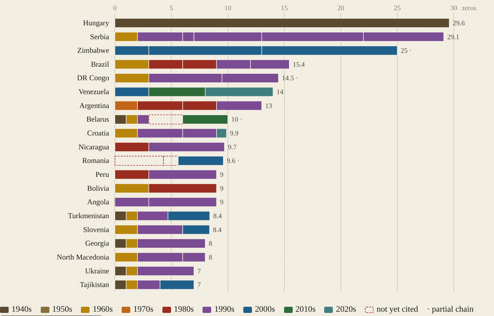
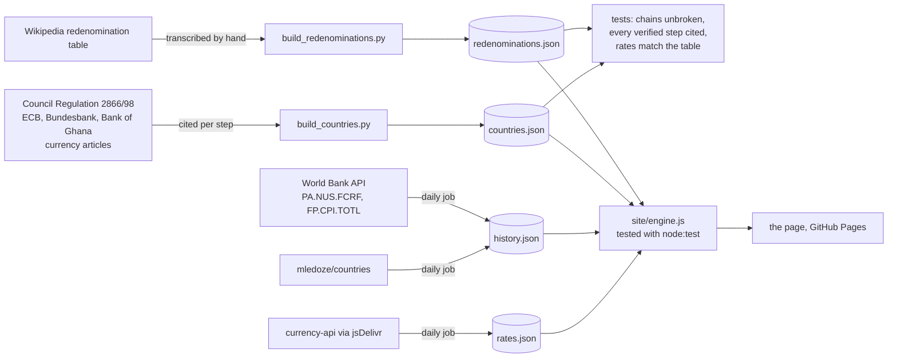

# Zeros Removed

[](https://github.com/kennethkimbrough/redenominations/actions/workflows/ci.yml)

**Every currency redenomination since 1945, chained together so you can ask
what an old banknote is worth in the unit a country uses today.**

Live: https://kennethkimbrough.github.io/redenominations/



When inflation runs far enough, the numbers stop fitting on the notes and a
country issues a new currency at a fixed rate to the old one: 1,000 old for 1
new, or in Hungary in 1946, 400,000,000,000,000,000,000,000,000,000 pengő for
one forint. This project collects those reforms as data, with a citation on
every figure, and builds three things from it:

- **A converter.** Pick a country, a year's currency and an amount, and it
  multiplies through every reform since: 1,000,000 Brazilian cruzeiros of 1945
  come out as 3.6 × 10⁻¹⁰ reais, 15.4 zeros later.
- **Dollars today.** The same result at today's exchange rate, and the reverse:
  how much of the old currency one dollar buys now (1.3 × 10³² pengő). A
  scheduled job fetches the rates daily from a keyless source and records the
  date; the site shows it with every result.
- **At the time.** Any of 215 countries, any year from 1960: the amount in
  that year's currency, in dollars of that year, and in today's dollars after
  US inflation. 1,000 Indian rupees in 1980 were $127, about $484 in 2024
  dollars. Uses the World Bank's annual official exchange rates and US
  consumer price index, fetched by the same daily job.
- **A chart** of zeros removed per country since 1945: one bar per country,
  one segment per reform, coloured by decade, drawn as plain SVG.
- **The full table**, filterable, with the rate and the number of zeros for each
  reform.

## Coverage, honestly

| | Count |
|---|---|
| Reforms in the table since 1945 | 129 (153 including earlier ones) |
| Countries with a fully cited chain from their first post-war currency to today | 68 |
| Countries with a partial chain (a reform with several rates, or a step with no fixed rate) | 7 |
| Countries not yet covered | about 120 |

A country is **verified** only when every step of its chain has a checked
source and the chain is unbroken, meaning each reform's new currency is the
next reform's old currency. The tests refuse anything else, so a country cannot
be marked verified by accident. Partial chains are shown on the site with the
missing step named, and the converter says when a result passes through an
uncited step.

The plan is to grow this country by country: add the next 10–20 chains, cite
each step against a central-bank or statutory source, and let the tests keep
the "verified" count truthful.

## How the data moves



Three GitHub Actions workflows: `ci.yml` rebuilds the JSON from the Python
sources and fails if it differs from what is committed, then runs both test
suites; `rates.yml` runs daily, refreshes the exchange-rate files, commits them
when they change and redeploys; `pages.yml` runs the tests and publishes
`site/`, then checks that the live URL answers.

## Where the numbers come from

- The table of reforms is transcribed from the
  [Wikipedia article on redenomination](https://en.wikipedia.org/wiki/Redenomination)
  (read 30 October 2026). It lives in `data/build_redenominations.py` as plain
  rows, so each one can be checked and corrected individually.
- Euro conversion rates come from
  [Council Regulation (EC) No 2866/98](https://www.legislation.gov.uk/eur/1998/2866/data.html),
  Article 1.
- Croatia's and Bulgaria's euro conversion rates come from the ECB press
  releases announcing them (12 July 2022 and 8 July 2025).
- Germany's 1948 reform cites the Bundesbank's own account, which is also why
  Germany stays partial: wages and rents converted 1:1, balances at less than
  1:10, and each person swapped 60 Reichsmark for 40 Deutsche Mark, so no
  single factor is exact.
- Steps the redenomination table leaves out, and the currency changes before a
  country's first redenomination (the West African pound to the cedi and the
  leone, the Egyptian pound to the Sudanese pound, the Portuguese escudos to
  the metical and the dobra, the Palestine pound to the Israeli pound, the
  Rhodesia and Nyasaland pound to the kwacha, Belarus in 2000, Vietnam in
  1985), cite the Wikipedia article on the currency in question, or the Bank
  of Ghana's own history for the cedi. Each source is listed with the sentence
  it supports in `data/countries.json`.
- Seven chains stay partial on purpose. Germany (1948), Austria (1945 and
  1947), Czechoslovakia (1953), Romania (1952) and Bulgaria (1952) converted
  money at more than one rate depending on the amount or the kind of holding,
  so no single factor is exact; the converter uses the rate for cash or small
  amounts and says so. The last Zimbabwean dollar was abandoned in 2009 with no
  fixed rate, and Timor-Leste's switch from the rupiah to the US dollar had no
  legal conversion rate either.

Today's exchange rates come from the
[currency-api dataset](https://github.com/fawazahmed0/exchange-api) published
daily to jsDelivr, with open.er-api.com as a fallback. These are published
market or official rates. In countries with a parallel street rate (Venezuela
and Argentina for long stretches, Bolivia recently) the dollar figure can be
well off what a money changer would give, and the site says so.

Historical rates are the World Bank's annual averages (indicator
PA.NUS.FCRF), and the inflation adjustment uses its US consumer price index
(FP.CPI.TOTL). The World Bank restates countries that redenominated in their
latest unit, so Brazil's 1980 rate is quoted in reais, not cruzeiros. For the
countries with a verified chain the site converts the amount along the chain
first, which makes the result right in the year's own currency; for other
countries that redenominated after the chosen year it warns by how much the
figure may be off. Venezuela is restated only to the 2008 unit, which is
handled; Zimbabwe's series mixes currencies and is not offered.

"Old per new" is the number of old units that bought one new unit. A rate below
one (Iran's 1932 toman to rial) means the new unit was the smaller one.

The converter says nothing about purchasing power. It only follows the legal
conversion rates, which is the point: it shows how much of a currency's
numbering was struck off, not what the money bought.

## Shareable links

Both converters write their state to the URL, so a result can be sent as a
link: `#c=HU.0.1000000` is a million 1945 pengő in the chain converter, and
`#t=IND.1980.1000` is a thousand 1980 rupees in the at-the-time converter.

## Layout

```
data/build_redenominations.py   the source table as rows → data/redenominations.json
data/build_countries.py         one chain per country with a source per step → data/countries.json
data/countries_more.py          further chains built from the same sources (Soviet and Yugoslav successors, euro members, others)
tests/test_data.py              chain continuity, citations, rates matching the table
site/engine.js                  the arithmetic, with no DOM: chain conversion, at-the-time conversion, formatting
site/app.js, index.html, css    the page (no build step, no dependencies)
tests/engine.test.mjs           node:test suite for engine.js against the real data files
.github/workflows/ci.yml        rebuilds the JSON, fails if it differs from what is committed, runs both test suites
.github/workflows/pages.yml     runs the tests, publishes site/ to GitHub Pages, checks the live URL
.github/workflows/rates.yml     daily: fetches USD rates into data/rates.json and redeploys
```

## Run it

```sh
python3 data/build_redenominations.py
python3 data/build_countries.py
python3 -m unittest discover -s tests -v      # data integrity
node --test tests/*.test.mjs                  # conversion arithmetic
mkdir -p site/data && cp data/*.json site/data/ && (cd site && python3 -m http.server 8000)
```

## Adding a country

1. Add an entry to `COUNTRIES` in `data/build_countries.py`: the currency in
   use at the start year, then one tuple per reform with the year, old and new
   currency names, old units per new unit, a source key and an optional note.
2. If the source is new, add it to `SOURCES` with a title, URL and the date you
   read it.
3. Run the build and the tests. A step that cites the Wikipedia table must
   appear there with the same rate; a chain with a gap fails; a verified
   country with an uncited step fails.

## License

MIT for the code. The data is compiled from the sources above under their own
terms; Wikipedia text is CC BY-SA 4.0.
